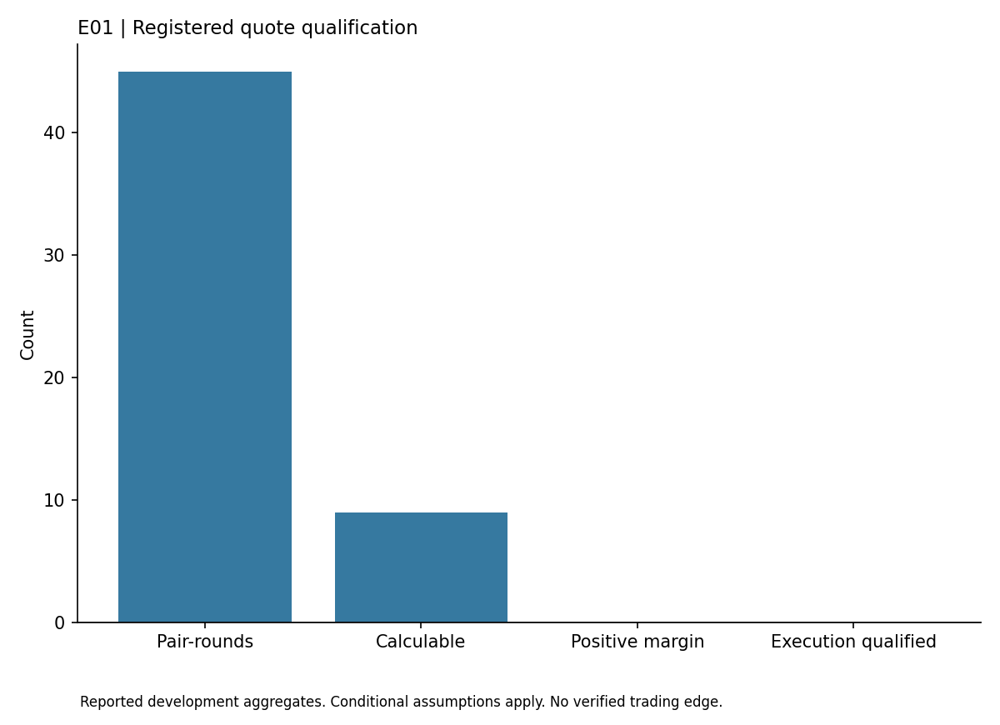

# Event Market Coherence

## Findings

This study tested whether related Kalshi weather contracts could be combined at a cost below their normal settlement payoff. The idea depends on the contracts describing genuinely nested outcomes with compatible settlement rules. Similar wording alone is not enough.

The registered capture collected 54 order books and produced 45 adjacent contract pair observations across three rounds. Only nine observations had the asks and displayed size required for the conditional calculation. All nine margins were negative.

None passed the execution checks. Local collection intervals of 7.10 to 11.59 seconds exceeded the two second limit, and exchange quote generation timestamps were absent. Settlement wording also left unresolved differences between the contract's named source and the city index provisions. The result provides no executable arbitrage candidate.

A second capture of the same cohort was outside the registered request budget. It remains excluded and is not confirmation of the first sample.

## Reading this report

This public copy contains the findings of one completed development study. Its chart uses only the small aggregate table in [findings.json](findings.json). The original research history, raw observations, source datasets and reserved confirmation periods remain private. This copy does not reproduce a historical backtest or establish an independently confirmed strategy.

Install matplotlib in your own Python environment, then run `python plot_results.py` to regenerate the chart. The script reads the saved table and makes no network requests. These are reported findings from the original study, not a fresh evaluation. Passing an integrity check or reproducing this chart does not validate profitability.

The [public file manifest](PUBLIC_FILES.json) records hashes of the report, aggregate table, chart script and figure. This copy was prepared without the original Git history so personal commit email addresses are not exposed. It grants no rights to underlying third-party datasets.
